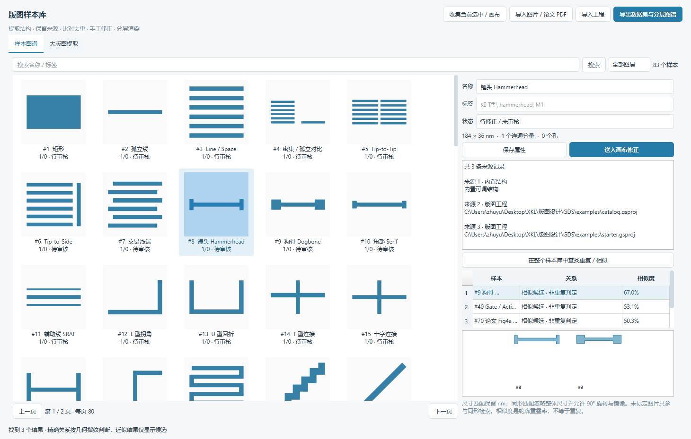

# GDS Studio

一个 Windows 桌面版图工具，用来生成、收集和整理 GDS 样本，方便后续做渲染和图像检测。

可以从已有版图里按层提取结构，也可以把论文截图里的轮廓转成多边形。收集到的样本放进本地库，做比对、去重和手工修正，再导出 GDS 或二值图片。



## 功能

- **画图和编辑**：放置参数化结构，调整线宽、间距和数量；支持顶点编辑、复制阵列、旋转、镜像、布尔运算和撤销。
- **结构生成**：内置 41 类结构，包括 line-space、锤头、T/L/U 型、蛇形、孔阵列和对准标记等，可批量扫描参数。
- **版图收集**：读取 GDS/OAS，按多边形、同层连通结构、Cell 或指定区域提取，保留图层和来源信息。
- **样本比对**：分别查找尺寸一致、旋转或镜像后相同，以及忽略整体尺寸的同形结构；也提供近似轮廓候选。
- **图片导入**：支持截图和 PDF 页面裁剪、两点标定、阈值提取及轮廓简化。手绘轮廓可以规整为正交或带 45° 边的多边形。
- **数据导出**：保存编辑工程，导出单样本 GDS、二值 PNG、分层平铺图谱和包含来源的 JSON/CSV 清单。

## 运行

需要 Windows 和 Python 3.11–3.12。在项目目录运行：

```powershell
powershell -ExecutionPolicy Bypass -File .\安装环境.ps1
.venv\Scripts\python.exe main.py
```

安装完成后也可以双击 `启动 GDS Studio.cmd`。首次安装需要联网下载依赖，之后可以离线使用。

如果已有打包版本，运行 `dist/GDS Studio/GDS Studio.exe`，保留整个目录即可。仓库中只放源码和示例，桌面包需要自行构建。

## 使用

新增精确编辑：`G` 按图案左上角整体移动；`D` 点选顶点 / 边，标注并输入尺寸驱动修改。
画布提供几何吸附、坐标标尺以及 1000–0.01 μm 比例尺预设。
操作见 [精确版图编辑](docs/CAD_EDITING.md)。
「图形 → 实验性 OPC 预览」可试用未标定的偏置 / 线端 / 角部补偿；
[7 nm 资料与适用范围](docs/OPC_7NM.md) 说明了它和真实工艺 OPC 的区别。

编辑器左侧选择结构，右侧修改参数，双击后在画布点击放置。滚轮缩放，空格或中键拖动画布；`Ctrl+D` 复制，`Ctrl+Z` 撤销，`F` 适应全部图形。

按 `Ctrl+L` 打开样本库。添加版图后选择 Cell、图层和提取方式；图库里选中样本可以查找重复，也可以送回画布修改。修改后用“收集当前选中 / 画布”保存到库里。

图片导入建议先裁掉文字和图框，再用两个已知距离的点标定。没有尺寸依据时，按未标定草图保存。提取结果可以继续修改顶点，但截图中被遮挡的几何需要手工补齐。

详细操作见 [样本库说明](docs/SAMPLE_LIBRARY.md)。`examples/` 中有起始版图、结构目录、参数扫描、图片提取和 [论文图形示例](docs/PAPER_SAMPLES.md)，也有一份包含 83 个样本的导出数据集。

## 文件与尺寸

| 文件 | 用途 |
|---|---|
| `.gsproj` | 保留结构参数、图层、几何和标定信息的编辑工程 |
| `.gds` | 提供给外部版图或检测工具的几何文件 |
| `.manifest.json` | 对应 GDS 的参数、Cell 和来源记录 |

内部坐标和界面尺寸使用 nm，GDS 数据库精度为 0.1 nm。导入其他单位的 GDS 会换算到 nm。样本库和自动保存文件位于 `userdata/`，不提交到仓库。

内置尺寸是可调整的测试值，工艺尺寸和层映射需要按实际任务设置。项目不包含晶圆厂 PDK、DRC 规则或曝光仿真。未标定图片的临时坐标不能作为物理尺寸使用。

大版图在独立进程中读取，仍需要把 KLayout 数据库加载到内存。默认按 Cell 定义收集，递归展开和 ROI 可以单独选择；数量超限会撤回本批写入，缩小区域后再提取。复杂整片版图建议分批处理。

## 开发

界面使用 PySide6，GDS 和层级数据处理使用 GDSTK / KLayout，轮廓处理使用 OpenCV / Shapely，样本库使用 SQLite。

```powershell
# 安装开发依赖并运行测试
.venv\Scripts\python.exe -m pip install -e ".[dev]"
.venv\Scripts\python.exe -m pytest -q

# 构建桌面版
powershell -ExecutionPolicy Bypass -File .\构建桌面版.ps1
```

测试覆盖几何读写、单位换算、孔洞、样本匹配和界面操作。一次 207.52 MiB、340 万多边形、40 层的合成文件测试中，索引约 0.87 秒，ROI 读取和提取约 1.16 秒；这只是该测试数据在本机的结果。环境和复现方法见 [测试记录](docs/VALIDATION.md)。

模块划分见 [架构说明](docs/ARCHITECTURE.md)，数据约定和扩展入口见 [开发笔记](docs/HANDOFF.md)，相关资料放在 [调研记录](docs/RESEARCH.md)。

## 许可

项目自有源码采用 [MIT](LICENSE)。包含 KLayout 的组合桌面发行版按 [GPLv3 或后续版本](LICENSE-DISTRIBUTION.txt) 分发。依赖许可和论文示例署名见 [THIRD_PARTY.md](THIRD_PARTY.md)。
